# AVA Fractalus

[](https://github.com/Harlock123/AVAFractalus/actions/workflows/build.yml)

A first-person rescue mission over fractal mountains, in the style of Lucasfilm Games' 1985 game **Rescue on
Fractalus!** It's built with .NET 10 and Avalonia UI. Pilots have come down on a hostile planet. Fly your
fighter over its mountains from the cockpit, land beside each one, and open the airlock when he knocks.
But look before you open: some of the "pilots" are Jaggi. With every pilot aboard, climb to the mother ship.

## Features

- **Fractal mountains**, drawn a pixel at a time the way the 8-bit machines did it. The landscape is a
  diamond-square height map that wraps round, and each screen column is a ray marched out over it. The
  rock is shaded by its slope and fades into the haze. Pilots, wrecks, guns, saucers and bolts are drawn into
  the same picture, each kept only where it's nearer than the ground. The low-resolution view is scaled up
  to fill the canopy.
- **Flying:** turn, climb and dive, faster and slower. Fly into a mountainside and it costs energy. Shields
  build back up slowly.
- **Landing:** only low, slow and on level ground. The pilot runs round to the front of the fighter, then
  to the airlock, and knocks.
- **The Jaggi:** some of the downed "pilots" are Jaggi. Wait a moment before opening, and its face presses
  against the canopy. Leave it there and it starts breaking in. Let it in and it hurts. Lift off and it
  falls away.
- **The Jaggi's guns** on the peaks fire at a fighter they can see (the ground hides you), but can't lift
  their barrels to anything far overhead. **Saucers** come after you, close in, and circle. Your sight
  leads a target near the line of fire, so bolts go where it will be.
- **The instrument panel:** a long-range scanner with the pilots' beacons and saucers, altitude above the
  ground, speed, heading, energy, and lights for LANDED, LANDING, AIRLOCK and WARNING. The ship's
  computer speaks: "All pilots in" and "Energy low".
- **Planet after planet**, each with more pilots to find, more Jaggi among them, more guns, faster saucers,
  and darker skies.
- **The attract mode** shows the computer pilot at work. It flies to the nearest beacon, keeping clear of
  the ground ahead and to either side, and slows to climb over ridges. It lands beside the pilot and waits
  to see the face before opening the airlock. It shoots what's in front of it, turns on saucers, and
  climbs to the mother ship when everyone is aboard.

## Screenshots

| The title | Over the mountains | A pilot running |
|:---------:|:------------------:|:---------------:|
| 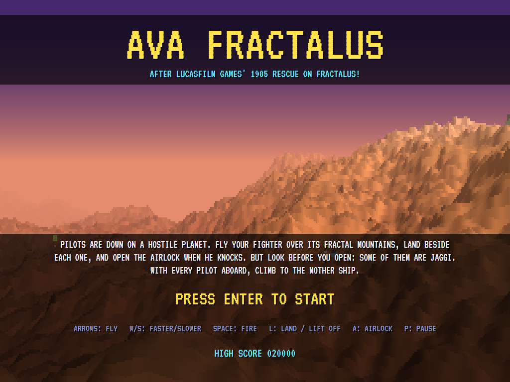 | 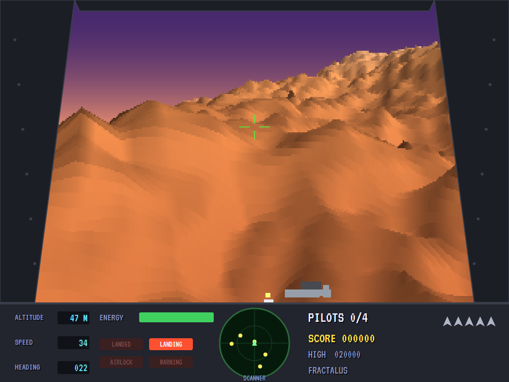 | 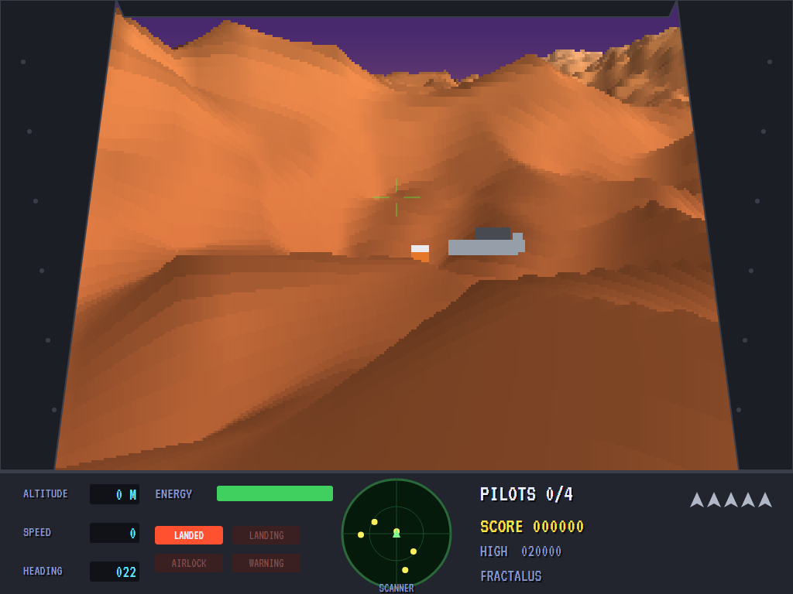 |
| The planet behind the title. | A wreck and its pilot ahead. | Landed: he runs to the fighter. |

| Knock knock | A Jaggi! | A gun on a peak |
|:-----------:|:--------:|:---------------:|
| 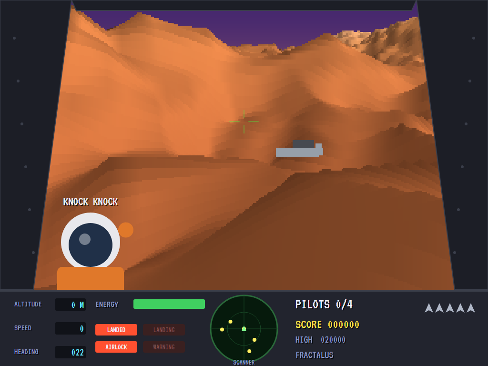 | 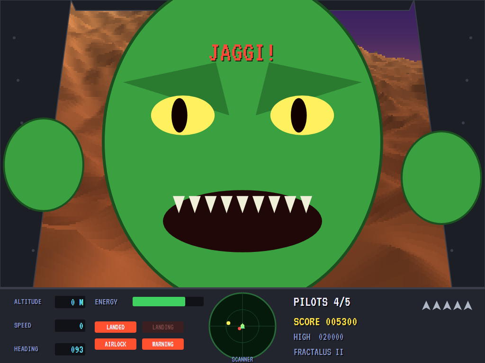 | 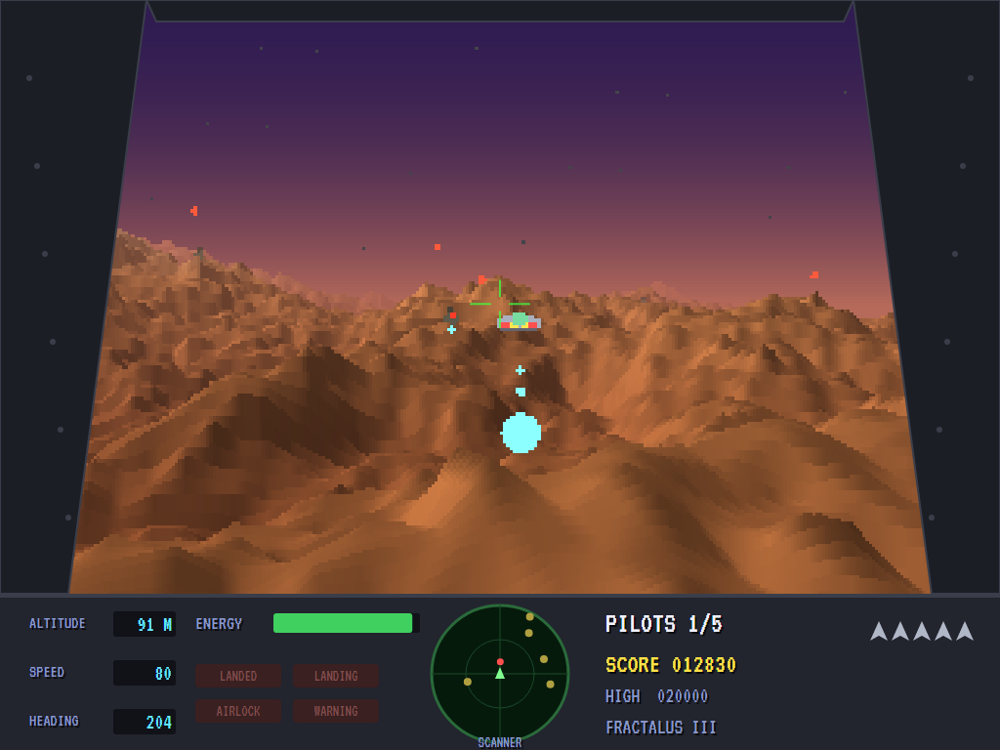 |
| A pilot at the airlock. | Not a pilot. | Bolts away. |

| A saucer | Night | Docked |
|:--------:|:-----:|:------:|
| 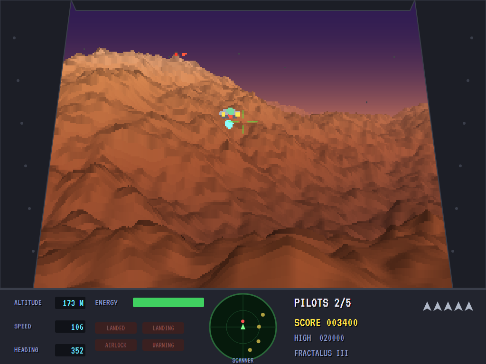 | 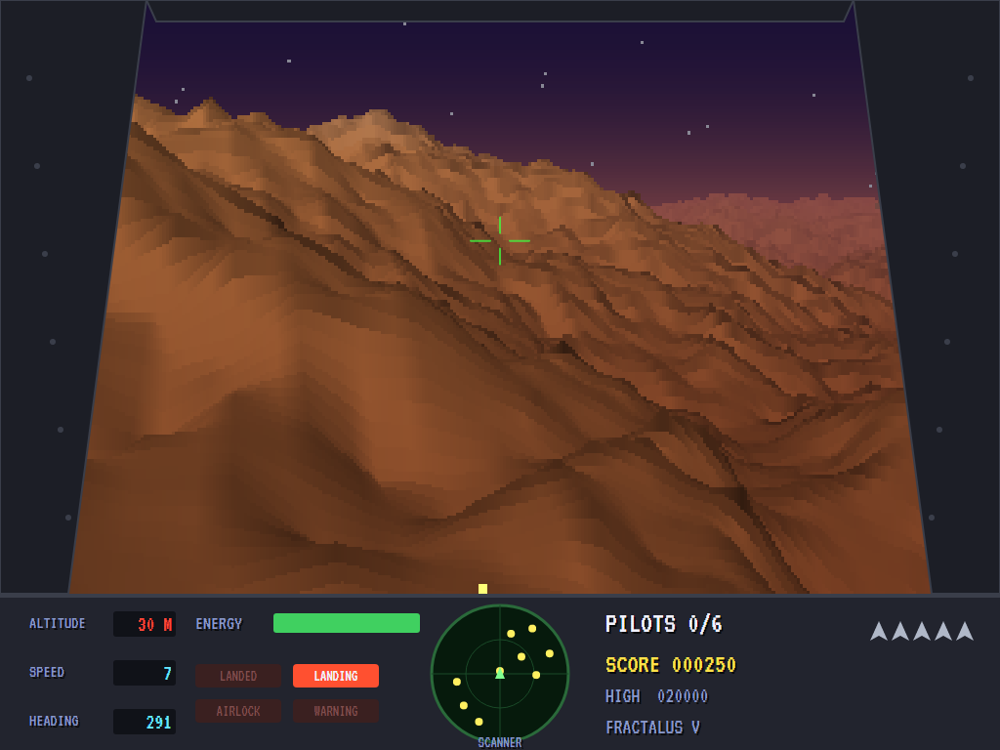 | 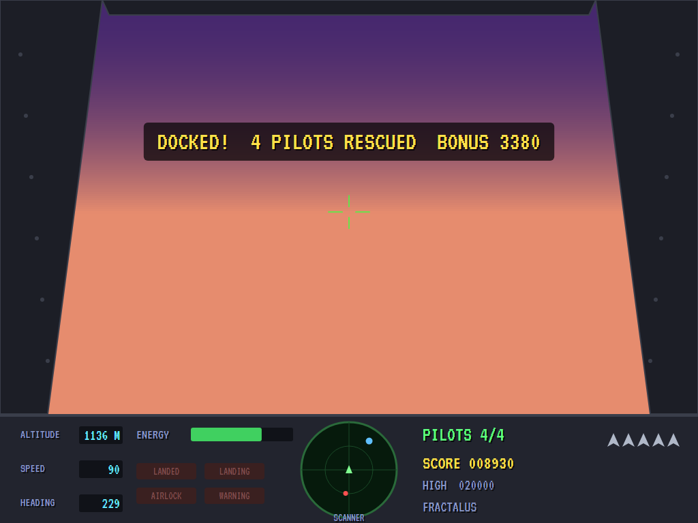 |
| Coming in over the ridge. | The fifth planet, after dark. | Every pilot aboard. |

| Game over | The top rescuers |
|:---------:|:----------------:|
| 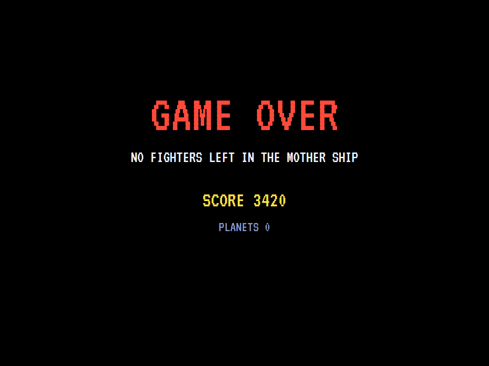 | 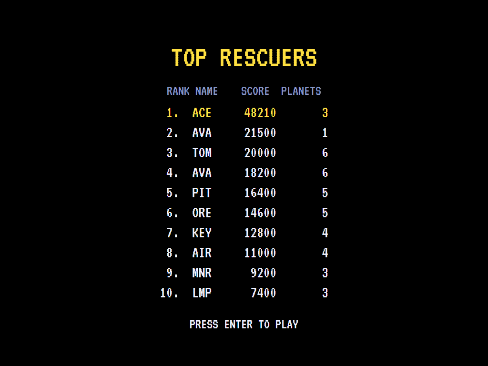 |

The screenshots are made by the tests, which play the game in a real (headless) window; see
[Tests](#tests).

## Download and run

Ready-to-run builds for Windows, macOS and Linux, on both Intel/AMD and ARM, are on the
[Releases page](https://github.com/Harlock123/AVAFractalus/releases/tag/latest). **Latest build** is
rebuilt on every push to `main`. Each download is one self-contained executable: no .NET install is
needed.

| Platform | Archive |
|---|---|
| Windows | `AVAFractalus-win-x64.zip`, `AVAFractalus-win-x86.zip`, `AVAFractalus-win-arm64.zip` |
| macOS | `AVAFractalus-osx-arm64.tar.gz` (Apple silicon), `AVAFractalus-osx-x64.tar.gz` (Intel) |
| Linux | `AVAFractalus-linux-x64.tar.gz`, `AVAFractalus-linux-arm64.tar.gz`, `AVAFractalus-linux-arm.tar.gz` |

```bash
tar -xzf AVAFractalus-linux-x64.tar.gz     # or linux-arm64, linux-arm, osx-arm64, osx-x64
./AVAFractalus
```

On Windows, unzip and run `AVAFractalus.exe`. On macOS, if Gatekeeper refuses to open it, run
`xattr -d com.apple.quarantine AVAFractalus` once. Run with `--no-audio` for silence.

**Sound** comes through OpenAL Soft, built in for every platform. In a virtual machine the game
detects it and uses a larger audio buffer, so the sound doesn't break up.

**Gamepads** use SDL2, which is bundled for Windows, macOS and Intel/AMD Linux. ARM Linux builds need it
installed; without it the keyboard still works:

```bash
sudo apt install libsdl2-dev            # Debian / Ubuntu / Raspberry Pi OS
sudo pacman -S --needed sdl2-compat     # Arch / Omarchy
```

## Controls

| Action | Keyboard | Gamepad |
|---|---|---|
| Start | Enter or 1 | Start |
| Turn | Left/right arrows | Left stick / D-pad |
| Climb / dive | Up / down arrows | Up / down |
| Faster / slower | W or + / S or - | Right / left trigger |
| Fire | Space, Z or Ctrl | A |
| Land, lift off | L | B |
| Open the airlock | A | X |
| Pause | P or Esc | Start or Back |
| Sound on/off | M | |
| Screenshot | Ctrl+S (to your Pictures folder) | |

On the high-score table, type your initials, or use up/down and Space, then Enter.

## Tests

```bash
dotnet test AVAFractalus.slnx
```

The game runs in fixed 60 Hz steps, so it plays the same at any frame rate. Everything that moves lives in
one world that can be copied. The tests check:

- **The planets:** pilots down on level ground, the right number of them Jaggi, and guns on the peaks; a
  surface that wraps without a seam; each planet darker, with more Jaggi and quicker guns, than the last.
  The computer pilot docks on every planet with every pilot aboard, losing no more than one fighter and
  never letting a Jaggi in. Shooting and nothing else rescues nobody.
- **Flying:** the way it heads, turning, climbing and diving; faster and slower; the surface wrapping
  round; a mountainside costing energy; shields building back up.
- **Landing and the airlock:** landing only low, slow and on level ground, then lifting off; a pilot
  running to the fighter, knocking, and let in; a Jaggi's face, breaking in, and hurting when let in;
  lifting off shaking off a Jaggi and leaving a pilot by his wreck; docking with every pilot aboard, and
  not before.
- **The Jaggi's weapons:** a gun with a clear shot firing, and taken out; a gun unable to reach far
  overhead; a saucer coming after the fighter, shot down with the leading sight.
- **The game:** docking with the energy bonus, then the next planet; the next fighter out of the mother
  ship; the last one lost and the high-score table; the demonstration; pause; the keys, through to the
  fighter; "all pilots in".

`tests/AVAFractalus.Tests/PilotProbe.cs` reports how the computer pilot gets on on each planet, for tuning
(`FRACTALUS_PROBE=1`; `FRACTALUS_PROBE=lazy` for a pilot who only flies straight and shoots).

The screenshot tests draw the real screen in a headless window. To refresh the README's pictures:

```bash
FRACTALUS_SHOTS=$PWD/Images dotnet test tests/AVAFractalus.Tests --filter ScreenshotTests
```

## Building

```bash
dotnet build AVAFractalus.slnx
dotnet run --project src/AVAFractalus
```

Needs the .NET 10 SDK. The sounds, tunes and voice are made by `tools/make_sounds.py` (standard-library
Python, with the formant voice in `tools/speech.py`): `python3 tools/make_sounds.py` rewrites
`src/AVAFractalus/Sounds`.

## Project structure

```
AVAFractalus/
├── AVAFractalus.slnx
├── src/AVAFractalus/
│   ├── Engine/
│   │   ├── GameEngine.cs        # States, fighters, planets in turn, docking, the title and demonstration
│   │   ├── Sim.cs               # A planet step by step: flying, landing, the airlock, guns, saucers, bolts
│   │   ├── World.cs             # Everything that moves, kept together so it can be copied
│   │   ├── Planet.cs            # The fractal height map, where the pilots and guns are, and the planets
│   │   ├── Autopilot.cs         # The computer pilot (the demonstration, and the tests)
│   │   ├── HighScoreTable.cs, InitialsEntry.cs
│   │   ├── InputHandler.cs, ControllerManager.cs  # Keys and an SDL2 gamepad
│   │   └── SoundManager.cs      # Effects, tunes and voice through OpenAL
│   ├── Audio/                   # The OpenAL engine (from the author's AVABand)
│   ├── Views/
│   │   ├── Renderer.cs          # The landscape, ray-marched a column at a time, and everything in it
│   │   └── GameCanvas*.cs       # The canopy, the Jaggi at the glass, the instrument panel, the title
│   └── Sounds/                  # The synthesised effects, tunes and voice
├── tests/AVAFractalus.Tests/    # Planet, gameplay and screenshot tests
├── tools/make_sounds.py, tools/speech.py
└── Images/                      # Screenshots
```

## About and licence

AVA Fractalus © 2026 Lonnie Watson, under the [MIT License](LICENSE).

*Rescue on Fractalus!* © 1985 Lucasfilm Games (published by Epyx); the names *Fractalus* and *Jaggi* belong
to their current owner. AVA Fractalus is an independent, unofficial game in its style. Its planets,
graphics, sounds, tunes and code are its own; nothing is taken from the original game's program, graphics
or sound. It is not affiliated with or endorsed by any rights holder.
